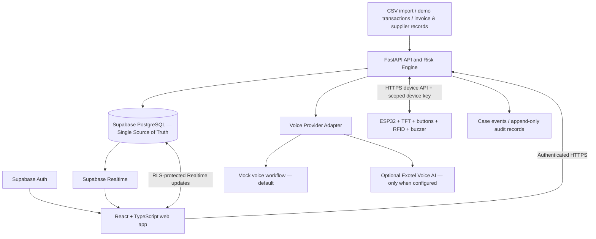

# LIRA — Unified Architecture & Antigravity Build Specification

**Document type:** Implementation blueprint / source-of-truth instructions for the coding agent  
**Product:** LIRA — Financial Fraud Detection & Investigation Platform  
**Version:** 1.0  
**Problem track:** F-01 — Financial Fraud and Transaction Risk Detection  
**Primary goal:** Build a genuinely runnable, integrated prototype—not just a design mock-up or scaffold.

---

## 0. Instructions to Antigravity — Read First

Build the application described in this document in the current workspace. Inspect existing files first and reuse useful work, but consolidate duplicate concepts into this single LIRA product. Do not create a competing product name such as PaySentry. The product name shown in the UI must be **LIRA**.

Implement the working vertical slice end to end:

1. Sign in / sign up.
2. Load demo transactions and suppliers into Supabase.
3. Analyse transactions with a transparent risk engine.
4. Create and group related activity into investigation cases.
5. View a case and its evidence on the dashboard.
6. Trigger an AI supplier-verification workflow (mock provider works by default; real provider is optional and disabled until configured).
7. Record a human-reviewed outcome and audit trail.
8. Keep laptop, mobile web/PWA layout, and ESP32 terminal aligned to the same Supabase-backed case state.

**Do not stop after creating a plan, scaffold, static screen, or mock dashboard.** Create the actual files, migrations, seed data, API routes, UI states, tests, setup instructions, and firmware skeleton. Run formatting, type checks, tests, and production builds where tooling is available; fix errors instead of hiding them.

If a third-party credential is unavailable, make that integration work through a clearly labelled mock/sandbox adapter. Never pretend that a mock call is a real call or that demo data came from a live bank. Do not ask the user questions that this specification already answers. If the workspace contains an existing app, adapt it rather than deleting unrelated user work.

### Non-negotiable product and safety rules

- Supabase PostgreSQL is the **single source of truth** for cases, transactions, suppliers, call outcomes, device state, and audit history.
- Use **React + TypeScript + Vite** for the web app and **FastAPI** for server-side risk assessment and privileged actions.
- Use Supabase Auth for human sign-in and Row Level Security (RLS) for tenant isolation.
- The Supabase secret/service-role key must exist only on the backend. Never place it in `VITE_*`, firmware, browser bundles, or Git.
- Every consequential change must be authorized server-side. RFID is operator association, not proof of identity and not a payment approval credential.
- LIRA does not directly freeze, release, or move real bank funds. It records recommended review states and decisions. Do not show a “funds frozen” state unless an explicitly implemented and tested external payment integration confirms it; for this prototype, show “Payment under review — action required in the business payment system.”
- A risk score is **not** a probability of fraud. A supplier answering a call does not prove identity or legitimacy. AI call outcomes are supporting evidence only.
- Never request or store OTPs, UPI PINs, bank passwords, card security codes, or other authentication secrets.
- No purple gradients, no decorative gradient backgrounds, no emoji in place of interface icons, and no low-contrast icons. Implement both light and dark mode.

---

## 1. Product Definition

### 1.1 What LIRA does

LIRA identifies suspicious financial activity, connects related transactions into an investigation episode, explains the risk factors, helps an authorized employee verify a risky supplier-payment request, and records a human-reviewed disposition.

### 1.2 Primary demo scenario

A business receives an invoice requesting payment to a supplier's newly changed bank account. The request is urgent and the beneficiary/contact route has not been independently verified. LIRA detects the combination of signals, opens a high-priority case, shows the old and proposed beneficiary context, and lets an authorized operator request a call to the supplier contact already saved in the trusted supplier profile. The AI assistant clearly identifies itself and asks whether the change request was made. The result remains unverified supporting evidence until a human reviewer independently decides what happens next.

### 1.3 Broader F-01 coverage

The supplier-payment scenario is the main demo, but the risk engine must also support:

- transaction amount deviations from a known baseline;
- unusually high transaction frequency / velocity;
- possible structuring patterns across multiple individually ordinary transfers;
- activity at unusual times relative to a known account or business schedule;
- beneficiary changes and first-time beneficiaries;
- repeated fan-in/fan-out and possible pass-through relationships;
- circular or otherwise unusual account relationships when data supports them;
- missing, stale, low-quality, or contradictory evidence.

Geolocation / impossible-travel rules are optional and **off by default** unless reliable source location and timestamps are provided. Never infer a location from an IP address and label it as verified GPS data.

### 1.4 What LIRA is not

- Not a bank or payment processor.
- Not a legally validated AML system.
- Not a production fraud model trained on labelled real-world banking data.
- Not a guarantee that a flagged event is fraud.
- Not an automatic bank-account lock / payment hold system.
- Not an AI caller that can authenticate a supplier on its own.

Use labels such as **Potential risk**, **Priority review**, **Evidence incomplete**, and **Awaiting verification**. Do not declare a person guilty or call a case confirmed fraud based only on heuristic rules.

---

## 2. System Architecture



### 2.1 Trust boundaries

1. **Browser / PWA:** untrusted client. Uses Supabase publishable/anon key and the signed-in user's JWT. It must never perform privileged case decisions directly in the database.
2. **FastAPI backend:** trusted application boundary. Validates the user's Supabase JWT, checks organization membership and role, validates request payloads, runs the risk engine, performs authorised writes, and creates audit records.
3. **Supabase:** persistent system of record. RLS protects exposed tables; migrations define schema, grants, indexes and policies.
4. **ESP32:** constrained device. Uses a device-specific API credential scoped to read the assigned case queue and send permitted acknowledgements / verification requests. It does not receive the Supabase service key or a human user's JWT.
5. **Voice provider:** external processor. Keep credentials server-side, validate callbacks, apply timeouts and rate limits, and persist minimal structured results.

### 2.2 Stack

| Layer | Required choice | Purpose |
|---|---|---|
| Web | React, TypeScript, Vite | Dashboard, investigation workbench, simulator, responsive PWA-style UI |
| UI styling | CSS variables + modern CSS (or Tailwind if already configured) | Consistent light/dark themes and accessible contrast |
| Icons | `lucide-react` | Clear consistent vector icons; no emoji icons |
| Charts | `recharts` (only where useful) | Risk trend, case distribution, transaction activity |
| Graph | `@xyflow/react` or a simple SVG graph | Visual relationships between accounts, beneficiaries and transactions |
| API | Python 3.11+ / FastAPI / Pydantic | Risk scoring, permissions, workflows, import, voice adapter, device API |
| Database/Auth | Supabase PostgreSQL + Supabase Auth + Realtime | Shared persistent state and login |
| Firmware | ESP32 DevKit V1, Arduino framework / PlatformIO | Physical case console |
| TFT | ILI9341 320×240 with TFT_eSPI (or a compatible tested library) | Case display |
| RFID | RC522 + registered tags | Operator association / demo maker-checker signal |
| Voice | Provider adapter; mock default, optional Exotel | Supplier clarification workflow |

Do not add a separate database (SQLite/localStorage) as a second system of record. Browser local storage may persist only the selected theme and non-sensitive UI preferences. The database remains the authoritative source for business state.

---

## 3. Repository Layout

Create this structure, adapting names only when an equivalent working structure already exists:

```text
lira/
├── README.md
├── ARCHITECTURE.md                    # this document
├── .env.example
├── docker-compose.yml                 # optional local helper; never embed secrets
├── package.json                       # root scripts if using a workspace
├── apps/
│   └── web/
│       ├── package.json
│       ├── index.html
│       ├── vite.config.ts
│       ├── src/
│       │   ├── app/                    # router, providers, query client
│       │   ├── components/             # buttons, badges, modals, tables, layout
│       │   ├── features/
│       │   │   ├── dashboard/
│       │   │   ├── investigations/
│       │   │   ├── transactions/
│       │   │   ├── suppliers/
│       │   │   ├── verification/
│       │   │   ├── simulator/
│       │   │   ├── audit/
│       │   │   └── devices/
│       │   ├── lib/                    # API client, Supabase client, date/currency
│       │   ├── hooks/
│       │   ├── styles/
│       │   └── main.tsx
│       └── public/
├── services/
│   └── api/
│       ├── pyproject.toml or requirements.txt
│       ├── app/
│       │   ├── main.py
│       │   ├── core/                   # config, auth, logging, errors
│       │   ├── api/v1/                 # routers
│       │   ├── schemas/                # Pydantic request / response models
│       │   ├── services/               # repository, risk engine, episodes, voice
│       │   ├── providers/              # mock_voice.py, exotel_voice.py
│       │   └── tests/
│       └── .env.example
├── supabase/
│   ├── config.toml
│   ├── migrations/
│   │   └── 0001_lira_schema.sql
│   ├── seed.sql
│   └── tests/                          # RLS / database tests if CLI available
└── firmware/
    └── esp32_lira_terminal/
        ├── platformio.ini
        ├── include/config.example.h
        └── src/main.cpp
```

Keep modules small and typed. Do not place the whole UI in one component or the entire API in one Python file.

---

## 4. Data Model — Supabase Is the Source of Truth

Use UUID primary keys, UTC `timestamptz`, `numeric(14,2)` for amounts, check constraints, foreign keys, and indexes for filtering and tenant access. The migration must be repeatable in a fresh local Supabase project.

### 4.1 Required tables

#### `organizations`
- `id uuid primary key`
- `name text not null`
- `created_at timestamptz default now()`

#### `organization_members`
- `id uuid primary key`
- `organization_id uuid references organizations(id)`
- `user_id uuid references auth.users(id)`
- `role text check in ('owner','admin','supervisor','analyst','viewer')`
- `active boolean default true`
- unique `(organization_id, user_id)`

#### `suppliers`
- `id uuid primary key`
- `organization_id uuid not null`
- `display_name text not null`
- `known_contact_name text null`
- `known_contact_phone text null` — demo only; in real deployment restrict access and protect sensitive data
- `trusted_contact_source text` — e.g. `pre_existing_vendor_profile`
- `current_beneficiary_fingerprint text null` — store an opaque fingerprint / masked reference, not full account data in demo UI
- `previous_beneficiary_fingerprint text null`
- `last_independently_verified_at timestamptz null`
- `business_hours jsonb null`
- `created_at`, `updated_at timestamptz`

#### `transactions`
- `id uuid primary key`
- `organization_id uuid not null`
- `external_id text null`
- `supplier_id uuid null references suppliers(id)`
- `account_ref text null` — pseudonymous internal reference only
- `counterparty_ref text null`
- `direction text check in ('incoming','outgoing')`
- `amount numeric(14,2) not null check (amount >= 0)`
- `currency char(3) not null default 'INR'`
- `occurred_at timestamptz not null`
- `beneficiary_fingerprint text null`
- `contact_route text null` — e.g. `known_vendor_channel`, `email_change_request`, `unknown`
- `source text not null default 'demo'` — `demo`, `csv_import`, or a future connected source
- `metadata jsonb not null default '{}'::jsonb` — validated non-secret feature data; do not dump raw invoices/emails indiscriminately
- `created_at timestamptz default now()`
- unique `(organization_id, external_id)` where external_id is not null

#### `cases`
- `id uuid primary key`
- `organization_id uuid not null`
- `case_ref text not null` — unique within organization, e.g. `LIRA-1042`
- `case_type text not null` — `supplier_payment_risk`, `transaction_sequence`, `beneficiary_change`, `network_anomaly`
- `title text not null`
- `summary text not null`
- `status text check in ('open','awaiting_verification','under_review','escalated','closed_verified','closed_rejected','closed_inconclusive')`
- `priority text check in ('low','watch','high','critical')`
- `risk_score integer check (risk_score between 0 and 100)`
- `evidence_confidence integer check (evidence_confidence between 0 and 100)`
- `data_completeness integer check (data_completeness between 0 and 100)`
- `amount_at_risk numeric(14,2) null` — estimate for review only, not a held amount
- `currency char(3) default 'INR'`
- `primary_supplier_id uuid null references suppliers(id)`
- `risk_reasons jsonb not null default '[]'::jsonb` — structured explanation, not a single free-text verdict
- `recommended_action text null`
- `opened_at timestamptz default now()`
- `updated_at timestamptz default now()`
- `closed_at timestamptz null`
- `version integer not null default 1` — optimistic concurrency / stale UI detection
- unique `(organization_id, case_ref)`

#### `case_transactions`
- `id uuid primary key`
- `organization_id uuid not null`
- `case_id uuid references cases(id) on delete cascade`
- `transaction_id uuid references transactions(id) on delete restrict`
- `relationship_label text` — e.g. `initiating_payment`, `related_transfer`, `beneficiary_change_context`
- `sequence_order integer null`
- unique `(case_id, transaction_id)`

#### `risk_assessments`
- `id uuid primary key`
- `organization_id uuid not null`
- `case_id uuid references cases(id)`
- `score integer not null`
- `priority text not null`
- `engine_version text not null`
- `signals jsonb not null`
- `missing_evidence jsonb not null default '[]'::jsonb`
- `created_at timestamptz default now()`

#### `verification_calls`
- `id uuid primary key`
- `organization_id uuid not null`
- `case_id uuid references cases(id)`
- `supplier_id uuid references suppliers(id)`
- `provider text not null` — `mock`, `exotel`, or another configured adapter
- `provider_call_id text null`
- `status text check in ('requested','queued','dialing','answered','no_answer','busy','failed','completed','cancelled')`
- `requested_by uuid references auth.users(id)`
- `contact_source text not null` — must be the saved trusted supplier profile, never an untrusted message
- `answer_category text null` — `confirmed_request`, `denied_request`, `unclear`, `no_response`, `not_applicable`
- `structured_summary text null`
- `uncertainty_note text null`
- `started_at`, `ended_at`, `created_at timestamptz`
- Do **not** store recordings or full transcripts by default. If a future deployment needs recording/transcription, add consent, retention, access, and legal review first.

#### `case_actions`
- `id uuid primary key`
- `organization_id uuid not null`
- `case_id uuid references cases(id)`
- `actor_user_id uuid null references auth.users(id)`
- `actor_type text check in ('human','device','system','voice_provider')`
- `action_type text not null` — `acknowledged`, `verification_requested`, `escalated`, `disposition_set`, `note_added`, `risk_recalculated`
- `from_status text null`
- `to_status text null`
- `note text null`
- `metadata jsonb not null default '{}'::jsonb`
- `created_at timestamptz default now()`

#### `audit_log`
- `id uuid primary key`
- `organization_id uuid not null`
- `actor_user_id uuid null`
- `actor_type text not null`
- `action text not null`
- `object_type text not null`
- `object_id uuid null`
- `request_id text null`
- `details jsonb not null default '{}'::jsonb`
- `created_at timestamptz default now()`
- Append-only from application perspective. No UI edit/delete route.

#### `device_registry`
- `id uuid primary key`
- `organization_id uuid not null`
- `device_name text not null`
- `token_hash text not null` — never store the raw device secret
- `active boolean default true`
- `last_seen_at timestamptz null`
- `firmware_version text null`
- `created_at timestamptz default now()`

#### `risk_rule_configs`
- `id uuid primary key`
- `organization_id uuid not null`
- `rule_set_name text not null default 'default'`
- `engine_version text not null`
- `weights jsonb not null`
- `thresholds jsonb not null`
- `enabled_signals jsonb not null`
- `updated_by uuid null`
- `updated_at timestamptz default now()`

### 4.2 Relationships

- Organization → members, suppliers, transactions, cases, devices, actions and audit rows.
- Supplier → its transactions, cases and verification calls.
- Case ↔ transactions through `case_transactions` (many-to-many).
- Case → multiple `risk_assessments`, `verification_calls`, and `case_actions`.
- Every tenant-owned row includes `organization_id`. Enforce tenant consistency in backend validation and, where practical, composite foreign keys / database constraints.

### 4.3 RLS and database security

- Enable RLS on every exposed tenant table.
- A signed-in member can `SELECT` rows only for organizations they actively belong to.
- Frontend clients are read-only for sensitive tables. Critical writes go through FastAPI after authorization checks.
- `audit_log` is append-only; do not grant client updates/deletes.
- Revoke unused `anon` / `authenticated` grants and grant back only necessary privileges. A policy alone does not remove an existing table grant.
- Add indexes on `organization_id`, case status/priority/date, transaction timestamp, supplier IDs, foreign keys, and policy filter columns.
- Add database tests for both allowed and denied tenant access. A non-member must not be able to read another organization's case, transaction, supplier, call, or audit event.
- Do not create unsafe exposed `SECURITY DEFINER` functions. If one is genuinely required, pin `search_path`, schema-qualify object names, and test it.

---

## 5. Risk Engine — Explainable and Testable

### 5.1 Scoring contract

Implement the engine as pure Python functions with unit tests. It must accept normalized transaction/supplier/context inputs and return:

```json
{
  "score": 78,
  "priority": "critical",
  "evidence_confidence": 68,
  "data_completeness": 75,
  "engine_version": "lira-rules-1.0",
  "signals": [
    {
      "key": "beneficiary_changed",
      "label": "Beneficiary details changed",
      "severity": "high",
      "points": 24,
      "observed": true,
      "evidence_refs": ["transaction-id-or-source-reference"],
      "explanation": "The proposed beneficiary fingerprint differs from the supplier's previously recorded fingerprint."
    }
  ],
  "missing_evidence": ["Independent contact confirmation not yet recorded"]
}
```

Use the same schema in API responses, case records, UI, audit details and simulator output. Keep the engine version with every assessment so a later rules change is traceable.

### 5.2 Default rule weights (demo baseline only)

Weights are transparent **priority points**, not statistically calibrated fraud probabilities. Make them editable/configurable, with versioned change history. Default points sum to 100:

| Signal | Max points | What it checks |
|---|---:|---|
| Beneficiary / bank-detail change | 24 | Current requested destination differs from the previously recorded supplier beneficiary |
| Contact-route mismatch | 18 | Request comes from an untrusted or unexpected route instead of the established channel |
| New or unseen beneficiary | 14 | Recipient has no established supplier/payment history |
| Velocity / possible structuring | 12 | Multiple related transfers exceed configurable account/vendor patterns |
| Amount drift | 10 | Amount differs meaningfully from a sufficient, relevant historical baseline |
| Urgency / unusual timing | 8 | Urgency or time pattern conflicts with available business/vendor context |
| Network / pass-through relationship | 9 | Connected accounts or rapid inflow/outflow patterns merit further investigation |
| Relevant prior risk context | 5 | A prior documented risk event or unresolved related case exists |

Each signal returns severity `0.0`, `0.5`, or `1.0` (or a documented bounded continuous value) and a clear explanation. Calculate `score = min(100, round(sum(weight * severity)))`. Keep weights in the database/config, not duplicated in front-end code.

### 5.3 Priority labels

Default configurable prototype bands:

- `0–24`: LOW
- `25–49`: WATCH
- `50–74`: HIGH
- `75–100`: CRITICAL

These are demo-operating thresholds and **not externally validated thresholds**. Display “Risk score (0–100; not a fraud probability)” in the UI and PRD/demo.

### 5.4 Evidence confidence and completeness are separate

Never merge evidence confidence into the risk score, and never pretend missing data means a signal is safe.

- `data_completeness`: expected useful fields present / expected fields for this case type.
- `evidence_confidence`: transparent heuristic for source quality, consistency and corroboration; label as a prototype estimate, not a calibrated statistical confidence.
- If a feature has insufficient baseline history, mark it `unknown` and add a missing-evidence note. Do not substitute zero spend, zero risk, or a fabricated average.
- A low confidence value must lead to “Review evidence / insufficient data” guidance, not a falsely precise verdict.
- A human-confirmed legitimate explanation may clear a particular signal only when supported by independent evidence; it must not automatically subtract unrelated risk points.

### 5.5 Episode grouping / connected activity

Build episodes for related activity rather than isolated alerts. The prototype can use deterministic rules:

- common supplier, account reference, beneficiary fingerprint, or related counterparty;
- close time windows configured for the rule;
- repeated small transfers / velocity bursts;
- rapid incoming-to-outgoing movement (pass-through candidate);
- multiple cases tied to one supplier-detail-change event.

Represent relationships as evidence-backed edges with a label and source transaction IDs. A graph relationship is an investigative lead, not proof of a conspiracy. Do not hardcode universal legal thresholds for structuring or AML reporting; make thresholds tenant-configurable and label patterns “possible structuring pattern.”

### 5.6 Baseline minimums

Use a known supplier/account baseline only when enough historical records exist (document a minimum sample count in configuration, e.g. 10 records for the demo). If the history is too small, use simple absolute/change signals and lower completeness/confidence. Do not train or claim a machine-learning model on synthetic demo data.

### 5.7 Risk engine test cases

At minimum, tests must prove:

1. A routine known-supplier payment with unchanged details is low risk.
2. Changed beneficiary + unexpected contact route becomes high/critical.
3. Several related small transfers generate an episode even if no individual amount is high.
4. A large payment alone does not automatically become fraud/critical.
5. Missing history lowers completeness/confidence and is explicitly surfaced.
6. Confirmed supplier change is not automatically accepted without required human controls.
7. A call unanswered or unclear does not count as verification.
8. The score is deterministic for identical inputs and engine version.
9. Scores remain within 0–100 and all reasons reconcile to the returned points.
10. Disabled or unavailable geolocation does not cause a geo rule to trigger.

---

## 6. FastAPI — Backend Contract

Use `/api/v1`. Add typed Pydantic request/response models, a consistent error format, request IDs, structured logs that do not expose secrets, and a health check.

### 6.1 Required routes

| Method | Route | Purpose / permission |
|---|---|---|
| GET | `/health/live` | Process liveness |
| GET | `/health/ready` | Check required config and database connectivity without exposing credentials |
| GET | `/api/v1/me` | Current authenticated user, organization membership, roles |
| POST | `/api/v1/onboarding/bootstrap` | Create a demo workspace for an authenticated user if they have no membership; never allow tenant selection from untrusted input |
| POST | `/api/v1/demo/seed` | Insert clearly marked sample supplier/transaction/case data; owner/admin only and only when `ENABLE_DEMO_SEED=true` |
| GET | `/api/v1/dashboard/summary` | KPI counts, risk trend, status breakdown and recent cases |
| GET | `/api/v1/cases` | Filter by status, priority, text query, page and page size |
| GET | `/api/v1/cases/{case_id}` | Case detail, transactions, assessments, call history and actions |
| POST | `/api/v1/cases/{case_id}/actions/acknowledge` | Acknowledge case; does not close or reduce risk |
| POST | `/api/v1/cases/{case_id}/actions/escalate` | Set escalation state and append reason |
| POST | `/api/v1/cases/{case_id}/disposition` | Human disposition with required note and role check |
| POST | `/api/v1/cases/{case_id}/verification-calls` | Request supplier call using only the saved trusted contact number |
| GET | `/api/v1/verification-calls/{call_id}` | Call status and structured result |
| POST | `/api/v1/transactions/import-csv` | Validate CSV rows, return imported/rejected counts and row-level errors |
| GET | `/api/v1/transactions` | Paginated transaction search and filters |
| GET | `/api/v1/suppliers` | Supplier list and beneficiary verification state |
| GET | `/api/v1/suppliers/{supplier_id}` | Supplier profile/history; mask sensitive details |
| POST | `/api/v1/simulations/run` | Run deterministic scenarios and persist if requested by an authorized user |
| GET | `/api/v1/audit` | Filterable append-only audit log; supervisor/admin roles |
| GET | `/api/v1/device/cases` | Device-authenticated minimal prioritized case queue |
| POST | `/api/v1/device/heartbeat` | Device state / firmware version / last-seen update |
| POST | `/api/v1/device/cases/{case_id}/acknowledge` | Physical acknowledge action only |
| POST | `/api/v1/device/cases/{case_id}/request-verification` | Request a call after permission and trusted-contact checks |
| POST | `/api/v1/webhooks/voice/exotel` | Provider callback; validate expected authentication, replay, call ID and status before state change |

Every case, supplier, transaction, call and device route must enforce organization scoping. Do not trust `organization_id`, role, `actor_id`, or priority supplied by the browser. Resolve them from the verified user/device and database membership.

### 6.2 State transitions

Use a server-side state machine; reject invalid transitions with HTTP 409 and a useful message.

```text
open → awaiting_verification → under_review → escalated
  └───────────────→ under_review
under_review → closed_verified | closed_rejected | closed_inconclusive
escalated → under_review | closed_verified | closed_rejected | closed_inconclusive
```

`acknowledge` changes the acknowledgement record / action log, not the disposition. A supervisor role is required to close a critical case as verified or rejected. All dispositions require a human identity and a short rationale. A voice call alone must never close a case.

### 6.3 Authentication and authorization

- Human requests: `Authorization: Bearer <Supabase access token>`. Validate through Supabase Auth / supported JWT verification; return 401 for invalid/expired token.
- For each request, read active `organization_members` membership and role from the database. Return 403 if a user lacks permission.
- Since the backend's service key bypasses RLS, every backend query must explicitly scope by the verified organization and relevant object IDs. Avoid “fetch by ID only” queries for tenant-owned objects.
- Device requests use `X-Device-Id` and `X-Device-Key`; compare a hash in constant time, verify that the device is active, rate-limit, and authorize only the small device route allowlist. Never send the device key to a browser.
- Never trust role or actor identity sent in request JSON.

### 6.4 Concurrency, idempotency and errors

- Use `cases.version` / conditional updates to avoid overwriting a change from another interface. Return 409 on stale versions and refresh the client.
- Use idempotency keys for CSV imports, calls and device POSTs to avoid duplicate calls/actions on retries.
- Standard error shape: `{"error":{"code":"CASE_VERSION_CONFLICT","message":"This case changed. Refresh and review the latest state.","request_id":"..."}}`.
- Validate and cap CSV size, row count, amount ranges, enum values and string lengths.

---

## 7. AI Calling Agent / Supplier Verification

### 7.1 Default behavior

Implement a `VoiceProvider` interface with:

- `MockVoiceProvider` — default and fully runnable without external credentials; advances status through a predictable demo script and clearly displays **SIMULATED CALL — NO REAL PHONE CALL WAS PLACED**.
- `ExotelVoiceProvider` — optional adapter enabled only by configuration and completed credentials; use the provider's current documented outbound Connect Voice AI API and status callbacks. If not configured or unavailable, show a clear error or stay in mock mode; never silently claim a real call happened.

### 7.2 Call flow

1. Analyst opens a case and selects **Request verification call**.
2. Backend checks role, case state, rate limit, supplier record, call eligibility and saved trusted contact source.
3. Backend creates a `verification_calls` row and audit action, then triggers provider adapter.
4. Agent identifies itself as an automated assistant calling on behalf of the business.
5. It asks only whether the supplier authorised the specific pending bank-detail/payment instruction. It should not disclose unnecessary customer/account information.
6. It never requests OTP, PIN, password, or payment credentials.
7. Store call status plus structured category: `confirmed_request`, `denied_request`, `unclear`, `no_response`, or `not_applicable`; store only minimal summary and uncertainty note.
8. The application shows the result as **supporting evidence — human review required**.
9. No answer, busy, unclear speech, suspected spoofing, or provider failure leaves the case unverified and recommends an independent call using established company controls.

### 7.3 Trusted contact safety

The destination number must come only from the supplier's previously established profile. Never call a number copied from the suspicious email/invoice as the verification number. Do not permit a client request to override the trusted number. In the demo, use synthetic numbers or the mock provider. Do not place real calls without explicit operator action and correctly configured credentials.

### 7.4 Exotel adapter requirements

- API credentials are backend environment variables only.
- Apply a short timeout, bounded retries, rate limiting and call-per-case controls.
- Verify the source/authentication of status callbacks according to the provider's current documentation; reject unexpected call IDs and stale/replayed updates.
- Map provider statuses to the internal enum in one adapter file.
- Do not assume a completed call means the human supplier answered; preserve answered-by/status metadata when available.
- Do not store recordings/transcripts by default.

---

## 8. Frontend — Required Screens and Behavior

Build a polished, responsive analyst console. Every visible control must work; do not leave dead buttons, dead tabs, or `href="#"` placeholders.

### 8.1 Routes

- `/login` — Supabase Auth sign in and sign up; helpful validation errors.
- `/` or `/dashboard` — KPIs, priority queue, trend, recent activity, connection state.
- `/investigations` — filterable sortable list of cases.
- `/investigations/:id` — case workspace with risk breakdown, evidence timeline, linked transactions, supplier details, network relationships, call state, and action panel.
- `/transactions` — search/filter/paginate imported transaction records.
- `/suppliers` — supplier list, known beneficiary fingerprint, verification freshness (mask sensitive fields).
- `/verification` — call queue, provider mode badge (`SIMULATED` / `LIVE PROVIDER`), call outcomes and uncertainty.
- `/simulator` — run normal payment, changed beneficiary, rapid small transfers, new supplier, missing evidence and false-positive scenarios.
- `/audit` — append-only action history with actor, timestamp, action, case, and reason.
- `/devices` — ESP32 registered devices, last-seen state, firmware version, stale/offline indicator.
- `/settings` — theme, profile, organization/risk rule display; sensitive rule changes restricted to admins.

### 8.2 Dashboard content

- Stat cards: open cases, critical cases, awaiting verification, escalated cases.
- Recent case queue sorted by priority and `updated_at`.
- Risk distribution chart with accessible labels and non-color-only meaning.
- Recent activity feed sourced from saved audit/action records.
- System health: API, database, Realtime, voice provider mode and device heartbeat.
- Prominent demo banner when using seeded data.

### 8.3 Investigation workspace

Use a two/three-column desktop layout that collapses to one column on mobile:

1. **Case summary:** case ID, status, priority, score and “not a probability” note.
2. **Why flagged:** each signal with points, plain-English explanation, transaction references and evidence freshness.
3. **Connected activity:** chronological sequence/timeline and a legible account/supplier relationship graph.
4. **Supplier verification:** saved trusted-contact source, call button, provider state and structured result.
5. **Actions:** acknowledge, request verification, escalate, set disposition; buttons disabled when the current role/status disallows the action.
6. **Audit history:** who did what, when, and why.

Do not communicate criticality with color alone. Always include words (CRITICAL/HIGH/etc.) and a clear icon/label. Do not place an unverified call outcome in the “verified” section.

### 8.4 Live synchronization

- Use a single `supabaseClient` initialized once from environment variables.
- Use FastAPI for initial reads and all business mutations.
- Use Supabase Realtime only for authorized, RLS-protected change notifications / refresh triggers on `cases`, `case_actions` and relevant call status rows.
- On receiving a realtime event, invalidate/refetch the affected API query rather than trusting a partial event payload as the full record.
- On reconnect, refetch authoritative state. Show `Live`, `Reconnecting`, or `Offline / stale data` status explicitly.
- No critical business state should be kept only in React state.

---

## 9. Visual Design System — Must Look Clean and Premium

### 9.1 Style direction

Use a finance-grade analyst console: calm, precise, minimal, high contrast, dense enough for case work but not cluttered. Use solid backgrounds, subtle borders, restrained shadows, clear spacing and readable typography.

**Explicitly forbidden:** purple gradients, neon gradients, glassmorphism overload, excessive glowing effects, random accent colors, emoji icons, tiny low-contrast labels, tiny click targets, decorative charts with no meaning.

### 9.2 Color tokens

Use CSS custom properties; all components must consume tokens rather than hard-coded one-off colors.

**Light mode**

```css
:root[data-theme="light"] {
  color-scheme: light;
  --bg: #F5F7FA;
  --surface: #FFFFFF;
  --surface-muted: #EEF2F6;
  --surface-elevated: #FFFFFF;
  --text: #17212F;
  --text-muted: #5F6B7A;
  --border: #DCE3EA;
  --primary: #176B87;
  --primary-hover: #12566D;
  --focus: #168AAD;
  --success: #237A57;
  --warning: #946200;
  --danger: #B42332;
  --info: #285FB8;
  --shadow: 0 8px 24px rgba(20, 35, 50, 0.08);
}
```

**Dark mode**

```css
:root[data-theme="dark"] {
  color-scheme: dark;
  --bg: #0F141A;
  --surface: #161D26;
  --surface-muted: #202A35;
  --surface-elevated: #1B2530;
  --text: #ECF2F8;
  --text-muted: #A6B3C2;
  --border: #33404E;
  --primary: #53B7D1;
  --primary-hover: #79CBE0;
  --focus: #7DD3E8;
  --success: #65C79A;
  --warning: #F0BD58;
  --danger: #FF7B83;
  --info: #88B4FF;
  --shadow: 0 8px 24px rgba(0, 0, 0, 0.24);
}
```

Risk colors must also have explicit text labels, border/icon cues and accessible contrast. Validate contrast, especially for status badges and muted text.

### 9.3 Layout and typography

- Desktop sidebar width: 232–256px; collapsible.
- Top bar: page title / breadcrumbs, search or quick filter, notification indicator if functional, theme toggle, profile menu.
- Main content max width around 1440px; use consistent 20–28px page padding.
- Use a system UI / Inter-style sans-serif stack. Use tabular numerals for money, counts, scores and IDs.
- Cards: 10–14px radius, 1px border, subtle shadow only where elevation helps.
- Tables: readable header, row hover, keyboard focus, explicit empty/loading/error states.
- Mobile: sidebar becomes a drawer; table rows become cards or horizontally scroll only where appropriate; no clipped action buttons.

### 9.4 Light and dark mode behavior

- Add a visible theme toggle using `Sun` and `Moon` icons from `lucide-react` with `aria-label`.
- Default to OS preference on first visit, then persist user's manual selection in localStorage.
- Set the root `data-theme` before rendering to avoid a flash of the wrong theme.
- Test every screen, modal, graph, chart, popover, form, dropdown and toast in both modes.

### 9.5 Icons

- Use `lucide-react` components at 16px for dense rows, 18–20px for buttons/navigation, 24px for major empty states only.
- Use consistent 1.75–2px strokes and align icons vertically with text.
- Give icon-only buttons accessible labels and tooltips. Never rely on an icon's color alone to communicate state.
- Recommended icons: `LayoutDashboard`, `ShieldAlert`, `ArrowLeftRight`, `Network`, `Building2`, `PhoneCall`, `FlaskConical`, `ClipboardList`, `Cpu`, `Settings`, `Sun`, `Moon`, `CheckCircle2`, `Clock3`, `AlertTriangle`, `CircleHelp`, `RefreshCw`, `ExternalLink`, `Search`, `Filter`, `ChevronDown`.

### 9.6 Motion and accessibility

- Keep motion subtle and short; respect `prefers-reduced-motion`.
- Use visible keyboard focus rings, logical tab order, semantic headings, labels connected to inputs, and accessible dialog behavior.
- Provide tooltip or text for unfamiliar financial terms.
- All alerts must include icon + text + meaning. Do not communicate status using red/green alone.

---

## 10. ESP32 Physical Terminal

### 10.1 Hardware

- ESP32 DevKit V1
- 2.8-inch ILI9341 TFT display (320×240)
- RC522 RFID reader + two demo tags
- Five physical buttons: UP, DOWN, LEFT, RIGHT, OK
- Piezo buzzer
- Zero PCB / prototyping board and suitable power supply

Do not add unrelated environment, motion, distance, gas or vibration sensors. They do not provide useful financial evidence.

### 10.2 Firmware behavior

- Connect to Wi-Fi using credentials supplied in a local, ignored config file.
- Retrieve a minimal case queue from the device API using a per-device key.
- Display case reference, priority label, risk score, brief reason, status, call state and server freshness.
- UP/DOWN: move between cases or evidence items.
- LEFT/RIGHT: switch `Queue`, `Case`, `Verify`, `Status` views.
- OK: inspect/acknowledge or request verification only after a clear confirmation screen; no close/reject/approve action on the device for v1.
- Buzzer: configurable short notification for a newly received CRITICAL case; default quiet mode on, with a software setting to enable. Do not repeat buzz continuously.
- RFID: record that a registered tag was presented / associate an operator label to an interaction. The backend still authenticates all sensitive actions; tag UID alone is not authorization.
- Heartbeat every 30–60 seconds when connected. Show `ONLINE`, `OFFLINE`, or `STALE` on the TFT.
- If network is unavailable, show last-sync time and “OFFLINE — actions not sent”. Queue only low-risk acknowledgement requests with request IDs if implemented; never queue an approval or payment action.
- Firmware must use TLS where supported and must not log secrets to serial output.

### 10.3 Suggested pin map — verify against the actual board and display

Keep the mapping in one config header and comment it. Avoid boot-strapping pins where practical. Shared SPI requires separate chip-selects.

| Signal | Suggested ESP32 pin |
|---|---:|
| SPI SCK | GPIO 18 |
| SPI MISO | GPIO 19 |
| SPI MOSI | GPIO 23 |
| TFT CS | GPIO 27 |
| TFT DC | GPIO 26 |
| TFT RESET | GPIO 25 |
| RC522 SS/SDA | GPIO 14 |
| RC522 RESET | GPIO 17 |
| UP button | GPIO 32 |
| DOWN button | GPIO 33 |
| LEFT button | GPIO 21 |
| RIGHT button | GPIO 22 |
| OK button | GPIO 4 |
| Buzzer | GPIO 16 |

This is a proposed default, not a claim that every board clone/display breakout has the same pins. Confirm with the actual modules before wiring; set each module's CS high while the other shares SPI. RC522 and ESP32 logic are 3.3 V; do not drive RC522 pins with 5 V. Document TFT_eSPI setup/pin configuration in firmware. Debounce buttons and handle RFID read failures.

### 10.4 Device protocol

Use JSON over HTTPS. Example minimized case:

```json
{
  "case_id": "uuid",
  "case_ref": "LIRA-1042",
  "priority": "critical",
  "risk_score": 78,
  "status": "awaiting_verification",
  "title": "Supplier beneficiary change",
  "reason_short": "New beneficiary + unexpected request route",
  "updated_at": "2026-10-24T10:00:00Z",
  "version": 3
}
```

Device POST requests include an idempotency UUID and `device_id`. The server derives the organization from the registered device record. No supplier phone number, full account number, raw transaction data or provider secret is sent to the device.

---

## 11. Seed Data and Simulator

Provide at least six clearly labelled demo scenarios:

1. **Normal supplier payment** — known supplier, unchanged beneficiary, normal amount.
2. **Changed beneficiary** — old/new beneficiary fingerprints differ.
3. **Changed beneficiary + untrusted route + urgency** — high-priority case; default showcase.
4. **Possible structuring / velocity** — multiple related transfers, each individually moderate.
5. **Pass-through candidate** — incoming transfer followed by rapid outgoing transfers to linked counterparties.
6. **Missing evidence / legitimate unusual activity** — insufficient history or an explained unusual payment; should demonstrate uncertainty and avoid automatic fraud labels.

Use fictional supplier names, synthetic account references, and clearly illustrative INR amounts. Use reserved/synthetic phone numbers and the mock voice adapter. Do not use real personal banking data. Seed endpoint should be idempotent, so running it twice does not duplicate cases or transactions.

The simulator should show:

- scenario name and the exact synthetic events created;
- risk factors that fired and point contributions;
- before/after score and case priority;
- evidence confidence/data completeness;
- resulting linked transaction episode;
- note that results are heuristic demo outputs, not a validated fraud prediction model.

---

## 12. CSV Import Requirements

- Provide a downloadable sample CSV template.
- Minimum columns: `external_id, occurred_at, direction, amount, currency, supplier_name, beneficiary_fingerprint, contact_route, account_ref, counterparty_ref`.
- Accept ISO-8601 timestamps with offset; convert stored times to UTC.
- Validate required columns, amount >= 0, currency format, direction enum, date parse, duplicate external IDs and file size.
- Return a row-level error report; do not fail the entire file silently because of one bad row.
- Use an idempotent key per organization + external ID. Missing external IDs must be handled explicitly (warn and create a deterministic import row ID, or reject; document the chosen behavior).
- Do not infer that an imported CSV is bank-verified. Show its source as `CSV import`.

---

## 13. Environment Configuration

Create `.env.example` with placeholders only; never commit secrets.

### Web `apps/web/.env.example`

```env
VITE_SUPABASE_URL=http://127.0.0.1:54321
VITE_SUPABASE_PUBLISHABLE_KEY=replace-with-local-publishable-or-anon-key
VITE_API_BASE_URL=http://127.0.0.1:8000
VITE_APP_NAME=LIRA
```

### API `services/api/.env.example`

```env
APP_ENV=development
APP_NAME=LIRA API
API_PREFIX=/api/v1
CORS_ORIGINS=http://localhost:5173,http://127.0.0.1:5173
SUPABASE_URL=http://127.0.0.1:54321
SUPABASE_PUBLISHABLE_KEY=replace-with-local-key
SUPABASE_SERVICE_ROLE_KEY=server-only-secret
ENABLE_DEMO_SEED=true
VOICE_PROVIDER=mock
EXOTEL_API_KEY=
EXOTEL_API_TOKEN=
EXOTEL_ACCOUNT_SID=
EXOTEL_CALLER_ID=
EXOTEL_STREAM_URL=
DEVICE_TOKEN_PEPPER=replace-with-random-secret
LOG_LEVEL=INFO
```

Prefer the current Supabase publishable/secret key nomenclature when available; support legacy anon/service-role keys only when required by the local project. Never add the service role key to a file used by Vite. Keep real local `.env` files in `.gitignore`.

---

## 14. Local Setup and Run Instructions

Document exact versions and commands that work with the generated repository. Recommended flow:

1. Install a supported Node.js version and Python 3.11+.
2. Install Docker and the Supabase CLI if using local Supabase.
3. Run `supabase start` from the repository root.
4. Run `supabase db reset` to apply migrations and seed data.
5. Use `supabase status` to obtain local API URL and publishable/anon key; place them in the web env file. Place the local service-role key only in the API env file.
6. Install and start FastAPI from `services/api` (use an isolated virtual environment and pinned dependencies).
7. Install/start the Vite app from `apps/web`.
8. Open the web app, create a user, then call the onboarding bootstrap endpoint to create the first organization. Run demo seed as the owner/admin.
9. Sign in and verify the dashboard and case workflow. Mock voice mode must work without external credentials.
10. Run the API tests and frontend production build.

Include root scripts if possible, for example `npm run dev` to run web + API via a documented concurrent runner, plus explicit separate commands for troubleshooting. Do not invent a Supabase key or provider credential. If Docker/Supabase CLI is unavailable, document a remote Supabase setup path using the same migration files.

### Minimum API commands

Use a pinned dependency file and explain the actual command created by the generated project. A typical setup may use:

```bash
cd services/api
python -m venv .venv
# Activate .venv for your OS
pip install -r requirements.txt
uvicorn app.main:app --reload --port 8000
```

### Minimum web commands

```bash
cd apps/web
npm install
npm run dev
npm run build
```

The README must contain OS-specific activation guidance for Windows PowerShell because the expected development machine may be Windows.

---

## 15. Security, Privacy and Financial Safety Checklist

- [ ] No secret/service-role key in frontend code, browser storage, firmware or repo.
- [ ] RLS enabled on every exposed business table.
- [ ] Positive and negative tenant-isolation tests pass.
- [ ] FastAPI validates JWT and checks membership/role for every private route.
- [ ] Tenant scoping is included in every backend query and update.
- [ ] Critical actions cannot be performed by altering client-side role/status fields.
- [ ] RFID tag is never treated as sole authentication or authority.
- [ ] Voice calls use the pre-existing supplier contact, not an untrusted request-supplied number.
- [ ] Voice callback is authenticated and mapped only to known provider call IDs.
- [ ] Rate limiting / duplicate-call protection is enabled.
- [ ] No OTP/PIN/password is requested or stored.
- [ ] Call transcript/recording disabled by default.
- [ ] CSV size/type and row values are validated.
- [ ] Audit history is append-only from application UI.
- [ ] UI distinguishes simulated vs live provider; demo data is labelled.
- [ ] Errors do not reveal secret values, raw stack traces, or cross-tenant records.
- [ ] Accessible labels, focus states, reduced motion, and both color themes are tested.
- [ ] No actual fund movement, freezing, or release is claimed.

Use OWASP API Security Top 10 concepts, especially object-level authorization, authentication, function-level authorization, unsafe consumption of external APIs, and security configuration, as a test checklist.

---

## 16. Required Tests and Acceptance Criteria

### 16.1 Build quality

- `npm run build` passes without TypeScript errors.
- Backend lint/type checks, import checks, and tests pass (configure tools if absent).
- All database migrations apply on a fresh local Supabase instance.
- Seed is repeatable and does not duplicate rows.
- No dead buttons, placeholder charts, or route pages that only say “coming soon.”

### 16.2 Workflow acceptance

1. User signs up, bootstraps a workspace, and seeds demo data.
2. Dashboard shows real rows returned by the API/database, not hardcoded frontend arrays.
3. A beneficiary-change scenario creates a case and a structured risk assessment.
4. Selecting a case shows linked transaction evidence and explains every fired signal.
5. Running the simulator writes the new state to Supabase; the laptop UI refreshes without a full reload.
6. Another authenticated browser session and the device queue can see the same updated server state when authorized.
7. Mock verification call is clearly marked simulated, moves through statuses, and writes a result and audit action.
8. An unanswered/unclear/denied call never marks the case verified automatically.
9. A human disposition requires an allowed role, rationale and current case version.
10. Every sensitive action appears in the audit log.
11. Attempted cross-organization reads/writes fail.
12. Offline/stale connectivity is visible, and the UI never reports a write as successful before the server confirms it.
13. Light and dark mode both work on all routes and persist across reloads.
14. The responsive app is usable at mobile widths and desktop widths.
15. ESP32 code compiles or any hardware-library limitation is explicitly documented; API-side device simulation should still be testable without hardware.

### 16.3 Visual acceptance

- No purple gradient or decorative gradient surface.
- Solid neutral light and dark backgrounds.
- Consistent Lucide icons, readable size and labels.
- Contrast and focus ring visible in both themes.
- Risk state includes both color and text.
- Skeleton/loading, empty, success, error, disconnected and stale states exist.
- Case timeline, risk breakdown and relationship graph are legible at presentation distance.

---

## 17. Implementation Order

Build in this order, ensuring the app runs after each stage:

1. **Repository and environment:** create files, lock dependencies, `.env.example`, lint/test/build scripts.
2. **Supabase base:** migrations, constraints, RLS, indexes, seed scenarios and tenant-isolation tests.
3. **API foundation:** config, health checks, auth middleware, tenant/role checks, structured error responses.
4. **Risk engine:** pure scoring functions, episode grouping and unit tests.
5. **Core workflow API:** cases, transactions, suppliers, simulator, case actions, audit log, CSV import.
6. **Web shell/design system:** routing, sidebar, theme provider, reusable components, auth pages, loading/error states.
7. **Functional pages:** dashboard, case list/detail, transaction list, supplier list, simulator, verification queue, audit, device status.
8. **Realtime sync:** subscribe to authorized row changes and refetch API queries.
9. **Voice adapter:** mock mode first; optional Exotel adapter behind env flags.
10. **ESP32 interface:** documented device endpoint + firmware UI; compile/test if hardware dependencies available.
11. **Quality pass:** tests, build, visual pass in both themes, security pass, README and demo script.

Do not build the physical screen before the database/API contract stabilizes. Do not build a separate native Android APK in v1; make the responsive web app/PWA-style interface work well on a phone first.

---

## 18. Final Demo Script

Use only synthetic data and make the scenario banner explicit:

1. Open the LIRA dashboard in light mode, then briefly show dark mode.
2. Select **Run demo: supplier beneficiary changed**.
3. Show the new `LIRA-1042` case appear in the list and, via Realtime refresh, on the second interface/device queue.
4. Open the case and explain the signal points, evidence confidence and missing evidence.
5. On the ESP32 terminal (or device simulator if hardware is not connected), inspect the case and request verification.
6. Trigger the mock calling agent. The UI must say **SIMULATED CALL — NO REAL PHONE CALL WAS PLACED**.
7. Show the structured result and uncertainty note. Keep the case awaiting human review.
8. Escalate it as a human, enter a rationale, and show the status update in the laptop/mobile/hardware views and audit log.
9. Run the normal-payment scenario to show LIRA does not label every large payment as fraud.

**Judge-facing one-liner:** “LIRA connects financial activity into explainable investigation cases, helps a business independently verify risky supplier payment changes, and keeps analysts, mobile users and a physical review terminal synchronized through one secure database.”

---

## 19. Research and Official References

Use these as the implementation source of truth where provider/platform details change. Check live docs before wiring a real provider; don't copy stale API payloads from blog posts.

1. **Supabase — Securing your data:** RLS, frontend publishable keys, and server-only secret/service-role keys.  
   https://supabase.com/docs/guides/database/secure-data
2. **Supabase — Row Level Security:** enable RLS, apply least-privilege grants, policies, indexes, and RLS tests.  
   https://supabase.com/docs/guides/database/postgres/row-level-security
3. **Supabase — Realtime architecture / Postgres changes:** server change delivery and authorized live updates.  
   https://supabase.com/docs/guides/realtime/architecture  
   https://supabase.com/docs/guides/realtime/getting_started
4. **FastAPI — Official tutorial:** typed request handling, errors, dependency injection and testing patterns.  
   https://fastapi.tiangolo.com/tutorial/
5. **Vite — Official guide:** React/TypeScript app scaffolding, build and development workflow.  
   https://vite.dev/guide/
6. **Exotel — Connect Voice AI API:** outbound call connected to a conversational AI bot through a bidirectional WebSocket; check account access and current parameters before production wiring.  
   https://developer.exotel.com/docs/agentstream/connect-voice-ai
7. **Exotel — Call details / status callbacks:** provider call status events; authenticate and validate callback behavior according to current provider documentation.  
   https://developer.exotel.com/docs/voice-v1/api-reference/call-details
8. **OWASP API Security Top 10:** object-level authorization, authentication, function-level authorization, unsafe external API consumption and configuration risks.  
   https://devguide.owasp.org/en/07-training-education/07-api-top-ten/
9. **FBI — Business Email Compromise:** independently verify payment/bank-detail changes via an established contact route.  
   https://www.fbi.gov/how-we-can-help-you/common-frauds-and-scams/business-email-compromise

Research-to-design interpretation: provider documentation supports the chosen integration patterns, but the default weights and priority bands in this prototype are **engineering starting values**, not published or validated financial fraud thresholds. Real deployment would require institution-specific policy, representative labelled data, formal security review, model/rule validation, privacy/legal review, and integration approval from the relevant payment provider.

---

## Definition of Done

LIRA v1 is ready for a demo only when an authenticated user can seed synthetic data, generate an explainable case, inspect related transactions, request a clearly labelled mock verification call, record a human disposition, and see the confirmed state reflected through the same Supabase-backed workflow; both themes must be polished, and security/validation checks must pass.
